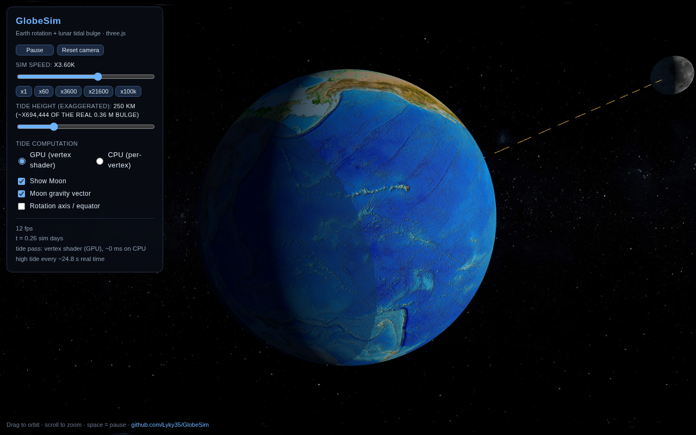

# GlobeSim

A real-time 3D simulation of planet Earth: a topographic globe rotating at the
true sidereal rate, with the Moon orbiting at its true sidereal period and a
translucent ocean whose water is raised into the classic **tidal bulge** by the
Moon's gravity.

Built with [three.js](https://threejs.org) (vendored, no build step) — runs on
any modern browser, no install required. The tide surface can be computed on
**either the GPU (vertex shader) or the CPU (per-vertex JavaScript)**, switchable
live from the UI.



## Features

- **Topographic Earth** — NOAA ETOPO1 global shaded-relief map (topography +
  ocean bathymetry), public domain, mapped onto a sphere.
- **True rotation** — one turn per sidereal day (23 h 56 m 04 s), axial tilt
  23.44°.
- **Moon** — orbits once per sidereal month (27.32 d), tidally locked face,
  orbital inclination 5.15°, optional dashed gravity vector toward Earth.
  (Drawn at 6.5 Earth radii instead of the real 60 so it stays on screen.)
- **Tidal bulge** — equilibrium tide
  `h(ψ) = A·(3cos²ψ − 1)/2` pinned to the Moon's direction: water piles up on
  the Moon-facing side *and* the antipode, while the ground rotates underneath,
  so any fixed point sees **two high tides per lunar day** (~24 h 50 m cycle).
- **CPU *or* GPU tide** —
  - *GPU*: displacement injected into the vertex shader; ~0 ms CPU per frame.
  - *CPU*: all ~15 500 ocean vertices re-positioned and re-normalled in
    JavaScript every frame (the stats panel shows the measured ms).
- **Controls** — sim speed ×1 … ×1 000 000 (log slider + presets), tide height
  0–1000 km with the exaggeration factor shown vs. the real ~0.36 m equilibrium
  tide, pause (space), camera reset, toggle Moon / gravity / axis.

## Run it

Any static web server works:

```sh
python3 -m http.server 8080     # or: npx serve .
```

then open <http://localhost:8080>. (`file://` won't work — ES module imports
need a server.)

## The physics, briefly

The Moon pulls harder on the near side of the ocean than on the solid Earth,
and harder on the solid Earth than on the far-side ocean. After subtracting the
mean (orbital) acceleration, what's left is a *differential* (tide-generating)
force that stretches the water into two bulges along the Earth–Moon line. The
real equilibrium amplitude is only ~0.36 m — about 0.000006% of Earth's radius,
invisible at planetary scale — so the sim exaggerates it and tells you by how
much. The Moon's gravity here is kinematic (the equilibrium-tide formula), not
an N-body integration; real ocean tides additionally involve basin resonance,
Coriolis and friction, which produce *co-tidal* patterns rather than one smooth
bulge. Roadmap items below include a full shallow-water solver.

## Texture credits

See [CREDITS.md](CREDITS.md). TL;DR: NOAA ETOPO relief (public domain),
Solar System Scope Moon & Milky Way (CC BY 4.0).

## Roadmap

- [ ] Real DEM displacement of the land sphere (ETOPO grid -> bump/displacement map)
- [ ] WebGPU / compute-shader variant + a CPU worker variant
- [ ] Shallow-water (Laplace tidal) equations on the sphere — co-tidal points, amphidromes
- [ ] Solar tide component (spring/neap cycles)
- [ ] Moon ephemeris (real orbital elements) and an actual Sun position for day/night
- [ ] City markers + local tide-height graph

## License

MIT (code). Textures have their own licenses — see [CREDITS.md](CREDITS.md).
